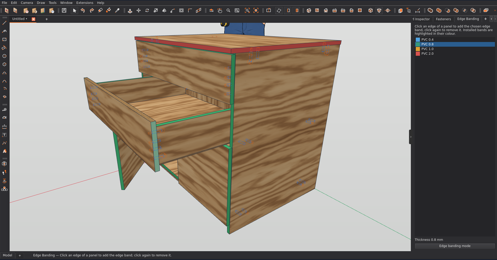
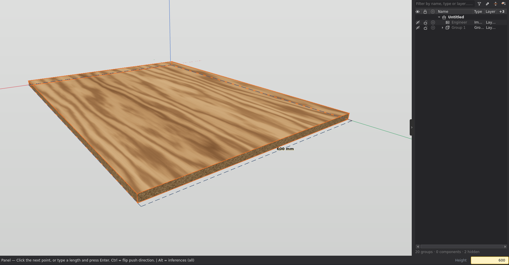
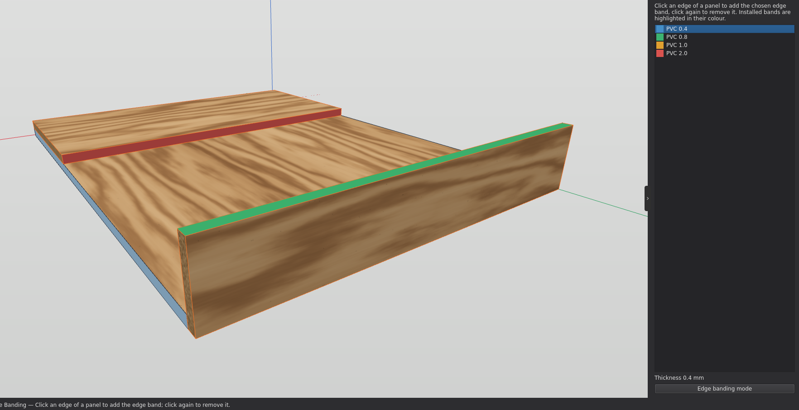
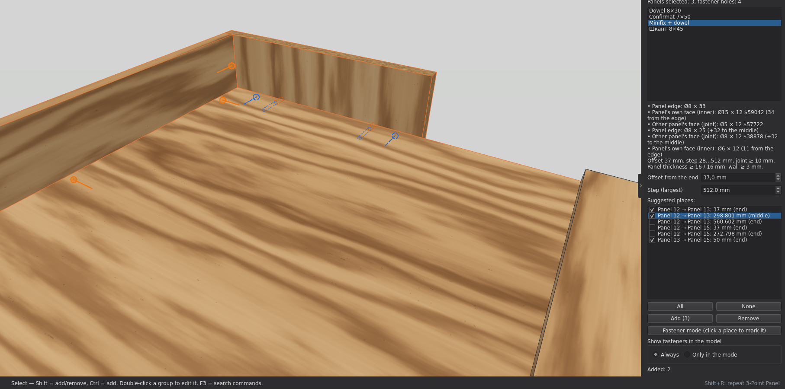
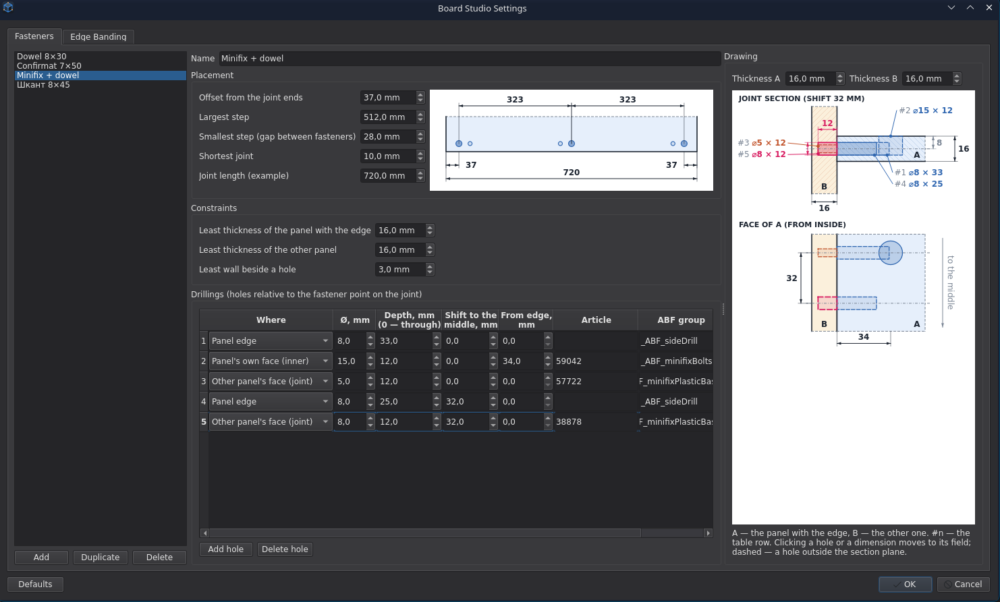
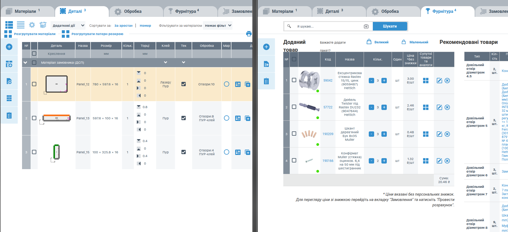
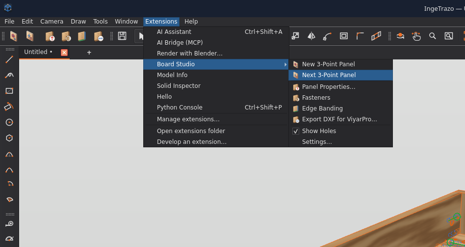

# Board Studio

An IngeTrazo extension for designing furniture and cabinetry from panels: draw a panel with 3 points, add edge banding and fasteners, and export the cutting list to ViyarPro as DXF.

## Features

### 3-point panels

Click the corner, the length and the height — or type the values and press Enter. Choose the board (chipboard, MDF, hardboard), its thickness and offsets. `Ctrl` flips the extrusion. **Next 3-Point Panel** draws again with the last settings, without the dialog.

Each panel is a separate group with oak decor on the faces and the board core on the edges.

### Edge banding

Pick a band in the side panel and click the edges of a panel: a click adds the band, a second click removes it. Banded edges are highlighted in the band's colour. Rounded corners and chamfers are banded too.

### Fasteners

Select the panels and pick a fastener (dowel, confirmat, minifix). Wherever the edge of one panel lies on the face of another, Board Studio suggests the places for the fasteners. Mark the ones you want and press **Add**. Holes are drawn in the model at their real size.

### Settings

A library of fasteners and edge bands, shared by all documents. A fastener is described by its offsets, step, constraints and a table of drillings, with a live drawing of the joint.

### Export DXF for ViyarPro

The selected panels (or all visible ones) are written in the format ViyarPro imports: grouped by material, laid out flat, with the cut contour inset by the edge banding, edge-banding marks and holes. Non-rectangular panels keep their real outline.

### Languages

English and Ukrainian, following the language of IngeTrazo.

## Installation

Copy the `board_studio/` directory into the IngeTrazo extensions folder (**Extensions** > **Open extensions folder**):

- **Linux (Flatpak)**: `~/.var/app/com.ingetrazo.IngeTrazo/data/ingetrazo/plugins/`
- **Linux**: `~/.local/share/ingetrazo/plugins/`
- **Windows**: `%APPDATA%\ingetrazo\plugins\`

Restart IngeTrazo.

## Usage

The commands are in **Extensions** > **Board Studio**, on the **Panel Creator** toolbar and in the context menu of a selected panel.

